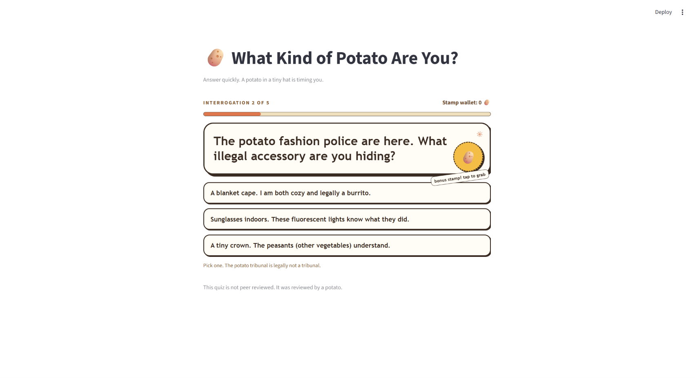

# What Kind of Potato Are You?

A short, silly quiz for anyone who wants a quick break from serious personality tests. Answer five absurd questions and find out which kind of potato the potato council thinks you are.

## How it works

The quiz shows one question at a time. Choose an answer and watch it tumble away; the next question then appears automatically. Your answers affect which of five potato characters you get at the end, and every result has its own illustration.

Two bonus potato stamps appear during the quiz. Click a stamp to collect it. Collect both to unlock a secret badge. After seeing your result, you can restart and play again.

The interaction is a loop: make a choice, see the quiz respond, then choose what to do next. The quiz is for fun and is not a scientific personality test.

## Screenshot



## Run locally

You need Python 3.10 or later and [uv](https://docs.astral.sh/uv/) installed. In a terminal, go to the project folder and run:

```bash
uv sync
uv run streamlit run app.py
```

Streamlit prints a local web address in the terminal. Open that address in your browser to play. The required Python dependency is declared in `pyproject.toml` and pinned in `uv.lock`. Result illustrations are in `assets/results/`.

## Limitations

This is a small local experience; a hosted live version is not currently provided. The bonus stamps are optional. The quiz uses a fixed set of questions and outcomes, and the result is based on the answer categories selected most often. If two categories tie, the first category in the program's result list wins.

## Credits

The quiz wording, code, and potato result illustrations were made for this project with AI assistance. See `PROCESS.md` for the design changes, user trial feedback, and tools used.

## Repository

[Public GitHub repository](https://github.com/LiZihui-Lucy/What-Kind-of-Potato-Are-You-)
